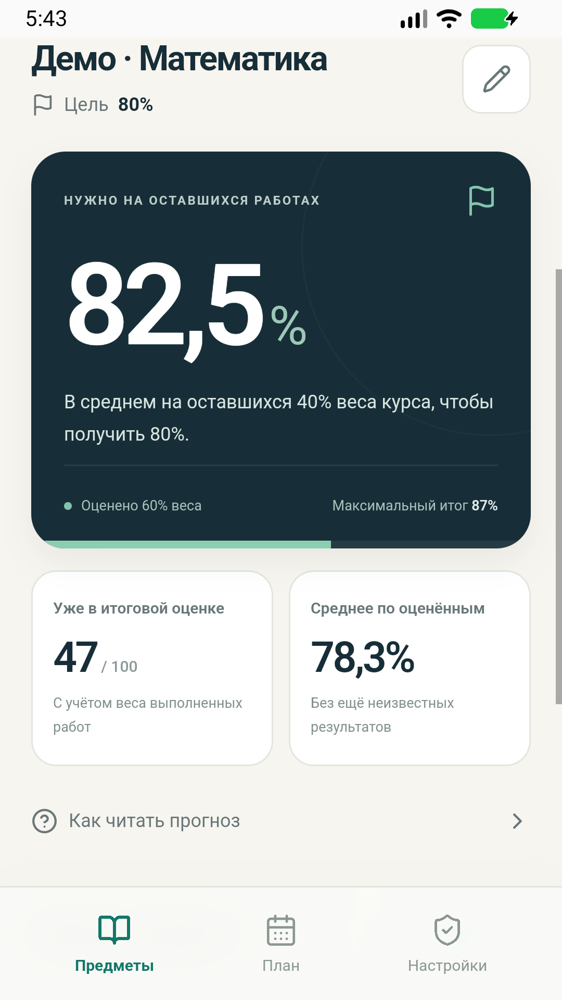

# GradeDock

An offline Android planner that answers **“What average score do I need on my remaining assessments?”** Built by Zalesh Sultan with React, TypeScript and Capacitor 8. Russian and English interfaces. No server, login, advertisements or network analytics.

## MVP

- Up to 30 courses, each with a custom target and up to 100 assessments.
- Editable percentage weights and points earned / maximum points. A blank result means pending; zero is an actual result.
- Required weighted average on remaining work, earned course points, completed-work average and best possible final result.
- Clear warnings for invalid weight totals, impossible targets and already secured targets. No silent normalization.
- Optional assessment dates and an upcoming-work view. Dates are a list, not reminder notifications.
- Local Android Preferences persistence, JSON export/import with validation and confirmation, recovery copy for damaged saves.
- On-device error codes with explicit diagnostics export. No course data in diagnostics.
- Original icon, feature graphics, RU/EN Play copy and privacy text.

This is a planning estimate, not an official university result. Enter the actual syllabus weights. Separate minimum exam requirements, curved grading, bonus credit and university-specific GPA rules are outside this MVP.



## Calculation

For each completed assessment: `contribution = points / maxPoints × weight`.

If weights total 100, `earned = sum(contribution)` and `remainingWeight = 100 − completedWeight`.

`requiredAverage = max(0, (target − earned) / remainingWeight × 100)`.

The result describes the **weighted average** needed on the pending work. It does not require exactly that score on every remaining assessment. With no remaining work the app shows the final result, without dividing by zero. Example: 26/30 at 30% and 21/30 at 30% bank 47 percentage points. An 80% target needs 82.5% on the remaining 40% final.

## Local development

Requires Node.js 22+, pnpm 11.19+, JDK 21, Android SDK 36 and Android build tools. Android Studio is optional for command-line builds; useful for device testing. Supported app devices: Android 7+ (API 24), Android System WebView/Chrome 107+. Older WebViews show an offline update-instructions screen.

```sh
pnpm install --frozen-lockfile
pnpm dev
pnpm test
pnpm build
pnpm test:ui
pnpm android:sync
cd android
./gradlew assembleDebug bundleRelease lint
```

On Windows use `gradlew.bat`. Set `JAVA_HOME` to JDK 21 and `ANDROID_HOME` to your SDK. The repository does not contain machine-specific paths or credentials. If the browser for UI tests is not installed, run `pnpm exec playwright install chromium`. The tests can also use an installed Chrome or Edge through `PLAYWRIGHT_CHANNEL=chrome` / `msedge`.

On a 16 GB PC, group edits and use incremental builds. Gradle is limited to two workers and a 1536 MB heap. Reuse one emulator, with `-gpu host` and hardware virtualization for a new session. TypeScript, Vite, tests and Gradle run on the CPU. Resource and validation details are in `docs/validation.md`.

Generate graphics with `pnpm assets` after the Android directory exists. Dependencies are locked in `pnpm-lock.yaml`; reviewed install scripts are limited to esbuild and sharp.

## Android deliverables and signing

`assembleDebug` creates `android/app/build/outputs/apk/debug/app-debug.apk`, signed with the local **debug** key, suitable for testing. `bundleRelease` creates `android/app/build/outputs/bundle/release/app-release.aab`. Without the owner's upload-key environment variables, the release AAB is **unsigned and cannot be uploaded to Google Play**.

To sign a release, the owner creates and securely backs up an upload keystore, then sets these process environment variables outside source control:

- `GRADEDOCK_KEYSTORE_PATH` — absolute path to the owner's upload keystore.
- `GRADEDOCK_STORE_PASSWORD`
- `GRADEDOCK_KEY_ALIAS`
- `GRADEDOCK_KEY_PASSWORD`

Build `bundleRelease` again and verify the signature. Do not publish a debug-key-signed app or put a keystore/password in Git. Enable Google Play App Signing in the owner's Console. No permanent key or legal agreement was created on the owner's behalf.

## Privacy and monetization

The app has **no INTERNET permission** and Android automatic backup is disabled. Preferences are local. User-triggered backup/diagnostics exports are written to app cache and offered to the system share menu. Exported external copies are the user's responsibility. Settings deletion removes active courses; clearing Android app storage removes recovery/cache as well. The bundled policy is `public/privacy.html`; review the developer/contact details and host it at a public URL before submitting to Play.

Monetization is one paid Google Play download; all features are included. Proposed test prices: **990 ₸ in Kazakhstan / US$1.99 in the US**, independently configured, not currency conversion. No Billing Library or ad account is needed for paid downloads. Actual sales, fees, payout timing and platform approval are not guaranteed.

Publication documents are in `docs/`. For a new personal Play account, plan for the required closed test and production-access application. The app is not yet published.

## Validation

See `docs/validation.md` for the actual completed checks, artifacts and remaining device/Play verification. Unit tests cover numerical boundaries, blank versus zero, invalid weights, impossible/secured/complete targets and untrusted backup data. UI tests cover real creation/editing, persistence and import behavior.

## Source and ownership

Original code and graphics remain the owner's property; no additional open-source license is granted. Third-party packages retain their respective licenses. This public repository is also a portfolio example of a small product taken through implementation, testing and Android packaging.
